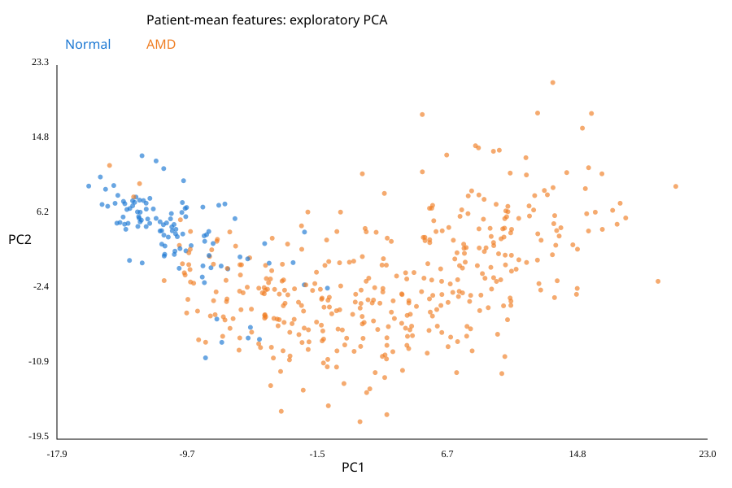

# retinal-oct-phenotyping

Retinal OCT phenotyping: AMD versus normal

Independent research portfolio project for Chukwuma Winner Obiora. Question: can image representations distinguish AMD from normal OCT scans in previously unseen patients?

## Status
Pixel, frozen ResNet18 central-crop and full-image padded baselines have been executed on real OCTDL data and reproduced in WSL. Preprocessing and AMD-stage analyses are exploratory. See RESULTS.md for results and limitations. This project addresses cross-sectional imaging analysis, not longitudinal progression or clinical deployment.

## Run on Windows PowerShell or Linux
Python 3.11 recommended. Allow several GB for the environment and data. A GPU is not required for the initial baseline.

```sh
python -m venv .venv
```
Activate on Windows: `.venv\Scripts\Activate.ps1`; Linux: `source .venv/bin/activate`.

```sh
python -m pip install -r requirements.txt
python download.py
python analyse.py --encoder pixels
python analyse.py --encoder resnet18
python analyse_padded.py --encoder resnet18
python summarise.py
python follow_up.py
```

ResNet18 is ImageNet-pretrained, not retina-pretrained. Its 512-dimensional frozen features provide a general transfer-learning baseline. Preprocessing follows torchvision's weight-specific transform, including central cropping; this may discard peripheral OCT information and requires visual inspection before scientific conclusions. Pixels are a deliberately simple 32x32 grayscale baseline. RETFound is a planned extension, not implemented or claimed as completed.

## Data
OCTDL v2: https://zenodo.org/records/10839556
Paper: https://doi.org/10.1038/s41597-024-03182-7
Official code: https://github.com/MikhailKulyabin/OCTDL
The metadata contains 1,231 AMD scans from 421 patients and 332 normal scans from 110 patients. Data files retain source checksums. Review original data terms before redistribution; the project package does not redistribute source images.

## Evaluation design
- Check identifiers, missing files, contradictory patient labels, image decoding and exact decoded duplicates across patients. Initial QC found cross-patient exact duplicates affecting 40 patients (132 scans). Conservatively exclude all affected patients, save an audit table, then remove identical scans within each remaining patient. This changes the cohort and may introduce selection bias; review the audit before interpreting results.
- Average scan features within each patient. This initial simplification discards eye/visit detail and is unsuitable for progression analysis.
- Use five-fold stratified cross-validation over patients. Every patient occurs in exactly one validation fold.
- Fit feature scaling and logistic regression on training patients only. No hyperparameter tuning; C=1, balanced class weights, threshold=0.5 are fixed.
- Save patient out-of-fold predictions, AUROC, balanced accuracy, sensitivity, specificity, confusion matrix, and a prior-only baseline.
- Bootstrap patient predictions for an approximate AUROC interval. This interval does not capture training/refitting uncertainty.
- Global PCA is descriptive only and never feeds model evaluation. Visual separation does not demonstrate generalisation.

## Outputs
`results/<encoder>/`: metrics.json, patient_predictions.csv, image_qc.csv, image_features.npz, nuisance_metrics.json, environment.json, pca.png. The shared duplicate audit is results/excluded_duplicate_patients.csv.

## Important research limitations and next work
Single-source evaluation has no external validation. Differences in acquisition, cropping, image dimensions, age or image quality could drive classification. Review error cases and compare with the included nuisance-only model using image dimensions/intensity before interpretation. No prospective holdout is claimed: OOF estimates may become optimistic if repeatedly used to select methods. A future comparison should use nested selection or reserve untouched patients before method development.

Next: investigate shared early-AMD errors, eye-level aggregation and near-duplicates; add OCT-specific RETFound features after verifying checkpoint provenance, modality and potential pretraining overlap; investigate subtype associations and cluster stability. Use OLIVES for a separate longitudinal extension only after auditing patient/eye/visit metadata and available clinical labels. Longitudinal data will require visit-level feature aggregation, mixed-effects modelling and chronology-aware validation.

## Application use
Describe methods you understand and can explain. Do not list retinal foundation-model experience, longitudinal modelling or a completed clinical model before actually completing those components.

## Additional results
- `results/resnet18_padded/`: full-image padded baseline outputs.
- `results/model_comparison.csv`: metrics regenerated from saved outputs.
- `results/preprocessing_comparison.csv`: paired patient predictions and correctness.
- `results/amd_stage_performance.csv`: exploratory AMD sensitivity by metadata stage.
- `results/shared_errors.csv` and `shared_error_metadata.csv`: shared misclassifications and retained-scan metadata.
- `results/resnet18/error_review.png` and `crop_review.png`: visual error review; these display selected scans rather than every scan used in patient aggregation.

`summarise.py` validates saved overall metrics and paired fold assignments without refitting models. `follow_up.py` reproduces error tables, metadata summaries, stage sensitivity and error/crop review figures from the downloaded metadata, extracted images and saved predictions. Use `python follow_up.py --tables-only` to skip figures. Dataset metadata and images are downloaded separately with `download.py`.

## Main findings
| Method | AUROC | Balanced accuracy |
|---|---:|---:|
| Pixel baseline | 0.793 | 69.7% |
| Frozen ResNet18, central crop | 0.991 | 95.0% |
| Frozen ResNet18, full scan with padding | 0.945 | 86.8% |
| Image dimensions/intensity baseline | 0.729 | 70.2% |

Evaluated on 491 patients after duplicate-related exclusions. Early AMD sensitivity was 91.2% with cropping and 74.3% with padding. The nuisance baseline indicates potential acquisition confounding. The preprocessing comparison was added after inspecting baseline errors and is exploratory. No external validation or calibrated clinical probability claim is made.



## Public repository contents
Source images, virtual environments, model weights, scan features and identifier-level results are excluded. Summary metrics, stage counts and exploratory PCA plots are included. Run the workflow to regenerate detailed outputs locally. The `.gitignore` prevents routine accidental tracking; it does not remove files that were already tracked.


## Verification
```sh
python -m unittest discover -p test_analysis.py
python summarise.py
python follow_up.py
```
The dependency ranges support installation; exact versions used in each recorded run are available in `results/<method>/environment.json`.
